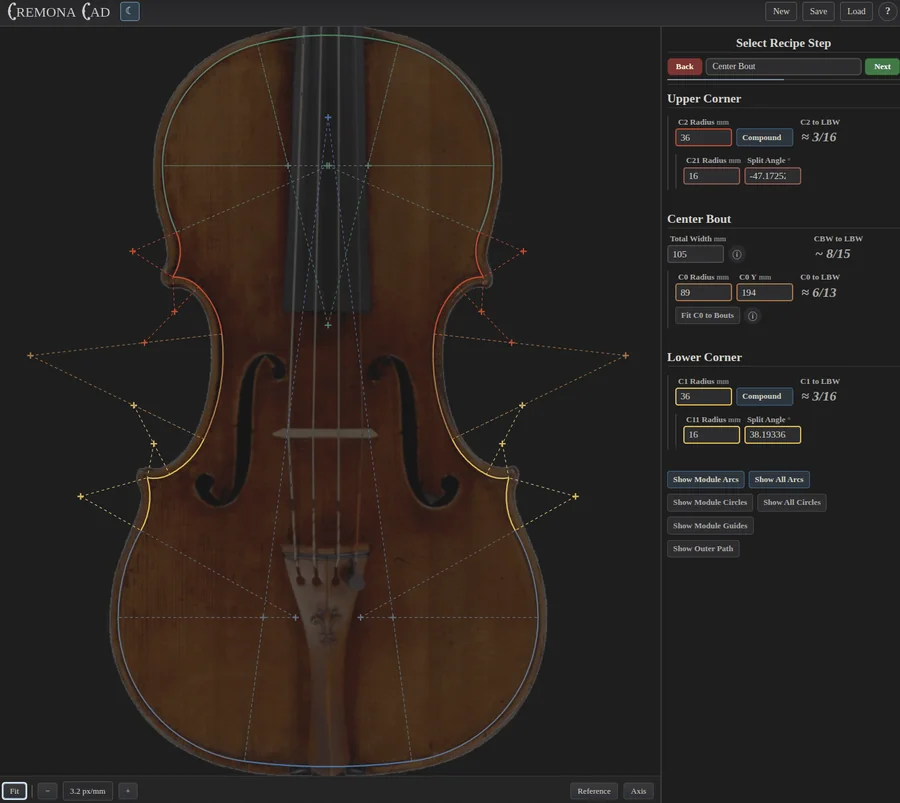

# Cremona CAD

A free and open source application for designing violin family instruments.

**[cremonacad.aargraves.com](https://cremonacad.aargraves.com)**

---


## About


CremonaCad draws instruments using a simple system of **intersecting arcs**, historically informed by a drafting document found in the workshop of **Enrico Ceruti**, as well as the research of American luthiers **David Beard** and **Kevin Kelly**.

The outline is drawn from parameters — bout widths, corner placements, cutoff angles — which then carry through to purfling, fluting, long and cross arching, and the internal mould. A **drawing toolbox** sits alongside the recipe for sketching and tracing directly on the canvas, snapping to the geometry underneath. Finished designs export as SVG, PDF and DXF for templates and moulds, and as STL for CNC-carved plates.

The in-app **Info Booth** (the **?** button) has the rest: the wiki, the release history, acknowledgements and the author. Every page in it is a Markdown file under [`src/app/docs/pages/`](src/app/docs/pages/), written to the [style guide](src/app/docs/pages/wiki/style.md).

## Getting Started

### Prerequisites

- [Node.js](https://nodejs.org/) v20.19+, v22.12+, or v24+
- [Angular CLI](https://angular.dev/tools/cli) v21+

```bash
npm install -g @angular/cli
```

### Run locally

```bash
git clone https://github.com/TheGravyBaby/cremona-cad.git
cd cremona-cad
npm install
ng serve
```

Open your browser to `http://localhost:4200`.

### Build

```bash
ng build
```

Output goes to `dist/`.

### Test

```bash
ng test
```

Unit tests run under [Vitest](https://vitest.dev/) via `@angular/build:unit-test`. Use `ng test --watch=false` for a single pass.

## For Developers

The `src/app/recipes/hello-world/` component is a minimal working recipe — the four-circle theory of violin outlines, in about 150 lines. A good starting point if you want to experiment with building your own.

Recipe components follow the structure established in `recipe-base/`, which owns the save/load file format, undo/redo, and the panel scaffolding. The draft canvas (`draft-canvas/`) accepts an array of draw functions and handles rendering, pan/zoom and the axis grid; it also hosts the drawing toolbox, whose shapes and reference images are saved into the recipe file alongside the parameters.

A few conventions worth knowing before editing geometry code:

- **World space is Y-up and measured in millimetres.** The canvas root group carries a `scale(1,-1)`, so anything appended to it is written in ordinary maths coordinates rather than SVG's Y-down ones.
- **Geometry math lives in `helpers/math/` (`simpleGeometry.ts`, `draftMath.ts`, `vibeMath.ts`).** Recipe calculations and canvas tools share it. `helpers/math/pathMath.ts` turns that geometry into path data; `helpers/renderFuncs.ts` draws it.
- **`models/types.ts` and `draft-canvas/tools/toolbox-shape.ts` are deliberately separate.** The former holds the classes recipes use; the latter is a plain-object union for the toolbox, which round-trips through JSON on every edit and so cannot carry prototypes. They share math, not types — see the notes at the top of each file.

## Project Structure

```
src/app/
├── docs/                  # Every word the app says to the user: field help, tooltips, conditions
│   ├── info-booth/        #   The info booth dialog, one tab per booth page plus wiki and history
│   ├── pages/             #   Every page it shows, one Markdown file each: booth/, history/, wiki/
│   ├── reader/            #   Parsing, the markdown subset, the page and contents-list components
│   ├── wiki/              #   The wiki tab
│   └── history/           #   The history tab
├── draft-canvas/          # SVG canvas, camera, axis grid
│   ├── tools/             #   Drawing toolbox: tools, snapping, layers, images
│   ├── tool-palette/      #   Toolbar
│   ├── settings-bar/      #   Per-shape properties for the current selection
│   ├── layer-controls/    #   Layers and reference images, under the canvas
│   ├── axis-controls/     #   Grid settings
│   └── edit-menu/         #   Selection actions
├── helpers/               # Math, render functions, SVG/PDF/DXF/STL export
├── models/                # Shared TypeScript types
├── recipe-base/           # Base class shared across all recipes
├── recipe-toolbar/        # Design name, file menu, export
├── recipes/
│   ├── hello-world/       #   Minimal recipe for experimentation
│   └── violin-family/     #   The instrument model
│       ├── panels/        #     One folder per design stage: its panel, its renders and its solver
│       └── templates/corpus/  #  Historical instruments traced from public museum records
├── settings/              # User preferences and the settings menu
├── shared/                # Message service and UI components
├── top-bar/               # Application toolbar
```

Earlier recipes (Enrico Ceruti, Beard, Kelly) live in the git history.

## Contributing

Feedback, ideas, and collaboration are welcome from anyone in the making community. Whether that's a new recipe method, improvements to the geometry engine, UI polish, or documentation — open an issue or submit a pull request.

```
git checkout -b feature/my-feature
```

## Tech Stack

- [Angular 21](https://angular.dev/) — standalone components, no state library
- [D3.js](https://d3js.org/) — SVG rendering and canvas interaction
- [jsPDF](https://github.com/parallax/jsPDF) + [svg2pdf.js](https://github.com/yWorks/svg2pdf.js) — PDF export
- [polygon-clipping](https://github.com/mfogel/polygon-clipping) — boolean operations on outlines
- [svg-path-properties](https://github.com/rveciana/svg-path-properties) — sampling paths into polylines off-screen
- [Vitest](https://vitest.dev/) — unit tests

## License

Copyright © 2026 Andrew Argraves.

Released under the **GNU General Public License v3.0 (GPL-3.0)**.

You are free to use, modify, and distribute this software under the terms of the GPL-3.0 license. Any derivative works must also be distributed under the same license. The full text is in [LICENSE](LICENSE).

## Author

Andrew Argraves. See [About Me](src/app/docs/pages/booth/about-me.md).
