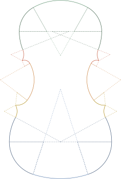

<picture>
  <source media="(prefers-color-scheme: dark)" srcset="public/CremonaCadLogoInitial-light.svg">
  
</picture>

A free and open source application for designing violin family instruments.

**[cremonacad.aargraves.com](https://cremonacad.aargraves.com)**

CremonaCad draws instruments by reconstructing their individual components using simple geometric relationships. The model uses a "bench first" pattern for construction, where each shape you design corresponds to actual concepts in real-world violin making. Shapes are primarily composed by smoothly joining various arc segments, informed by research into 17th-century Italian instrument making. 

<picture>
  <source media="(prefers-color-scheme: dark)" srcset="public/CC_Drawing.svg">
  
</picture>

The application allows for the uploading and scaling of reference images, and features a wide array of drafting tools. The geometry systems are quite robust, supporting many different permutations, and track very well against real instruments. 

CremonaCad comes with several high-quality copies of historical Cremonese instruments, using publicly available images and data from the Library of Congress. You can start with one of these recipes or build your own. 

Once your design is complete, you can export scaled PDFs, SVGs, or DXF files for many critical violin making components. 

There is more robust documentation of the various components within the application itself. Its pages are Markdown files under [`src/app/docs/pages/`](src/app/docs/pages/) and can be viewed as a wiki.

## Running locally

Requires [Node.js](https://nodejs.org/) v20.19+, v22.12+, or v24+.

```bash
git clone https://github.com/TheGravyBaby/cremona-cad.git
npm install
npm start
```

Then open `http://localhost:4200`.

`npm run build` writes a production build to `dist/`. `npm test` runs the tests.

## License

Copyright © 2026 Andrew Argraves. Released under the [GPL-3.0](LICENSE).
